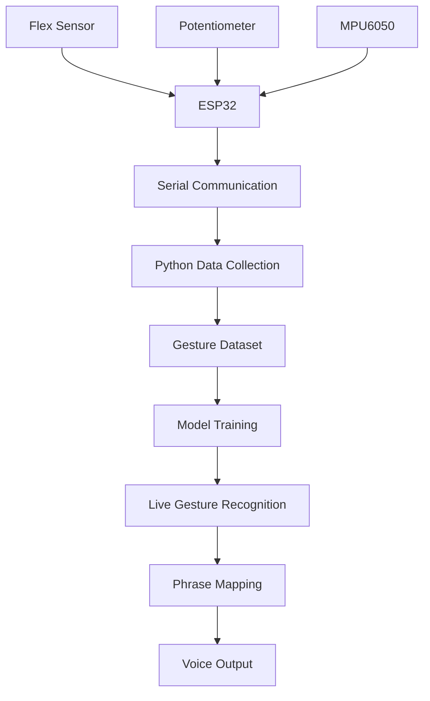

# Kural
### An ESP32-Based Gesture-to-Speech Assistive Communication System

**Kural** is a hardware-based assistive communication prototype that combines finger movement, rotary input, and wrist orientation to recognize predefined communication gestures and convert them into spoken phrases.

Built using an **ESP32, a flex sensor, a potentiometer, and an MPU6050 accelerometer/gyroscope**, the system explores an affordable approach to gesture-based communication.

The project focuses on demonstrating how multiple low-cost sensors can work together to identify physical gesture patterns and map them to meaningful communication outputs.

---

## Project Overview

Kural uses three sensor inputs to distinguish between different gesture states:

- **Flex Sensor:** Detects finger bending and straightening.
- **Potentiometer:** Provides an additional intentional input to distinguish gesture categories.
- **MPU6050:** Captures wrist orientation using accelerometer and gyroscope readings.

The ESP32 collects sensor readings and streams them to a Python-based data collection and machine learning pipeline.

The collected data is used to train a gesture classification model, which can subsequently be evaluated through a live recognition pipeline.

## System Architecture



## Hardware Components

| Component | Purpose |
|---|---|
| ESP32 Development Board | Main microcontroller |
| Flex Sensor | Detects finger bending |
| Potentiometer | Provides intentional gesture-category selection |
| MPU6050 | Measures wrist orientation and motion |
| Resistors | Flex sensor voltage divider |
| Jumper Wires | Hardware connections |
| USB Cable | Programming and serial communication |
| Speaker / Audio Output | Intended spoken communication interface |

## Hardware Connections

### ESP32 Pin Configuration

| Component | ESP32 Pin |
|---|---|
| Flex sensor divider midpoint | GPIO 32 |
| Potentiometer middle pin (wiper) | GPIO 34 |
| Potentiometer outer terminal 1 | 3.3V |
| Potentiometer outer terminal 2 | GND |
| MPU6050 SDA | GPIO 21 |
| MPU6050 SCL | GPIO 22 |
| Common Ground | GND |

### Wiring Reference

```text
ESP32
│
├── GPIO 32  → Flex Sensor Divider Midpoint
│
├── GPIO 34  → Potentiometer Wiper
│
├── 3.3V     → Potentiometer Outer Terminal
│
├── GND      → Potentiometer Other Outer Terminal
│
├── GPIO 21  → MPU6050 SDA
│
└── GPIO 22  → MPU6050 SCL
```

**Hardware Safety:**
- Never supply 5V to the potentiometer input connected to GPIO34.
- Keep the potentiometer connected between 3.3V and GND.
- Never connect the potentiometer wiper directly to GND while its outer terminal is connected to 3.3V.
- Disconnect USB power before changing hardware connections.

---

## Gesture Recognition Design

Kural uses three physical input conditions to distinguish gesture categories.

### 1. REST State

The default neutral position.

- Flex sensor: Approximately 190–210.
- Potentiometer: Low, approximately 820.
- Wrist: Neutral orientation.

### 2. FLEX-Based Gestures

The flex sensor is intentionally bent while the potentiometer remains low.

- Flex sensor: 245 or higher.
- Potentiometer: 1400 or lower.
- Wrist: Five different orientations.

### 3. POT-Based Gestures

The flex sensor remains relatively straight while the potentiometer is deliberately rotated to a high value.

- Flex sensor: 235 or lower.
- Potentiometer: 2400 or higher.
- Wrist: Five different orientations.

### Wrist Orientation Classes

The MPU6050 captures five different wrist positions:

| Position | Description |
|---|---|
| LEFT | Wrist oriented towards the left |
| RIGHT | Wrist oriented towards the right |
| UP | Wrist oriented upwards |
| DOWN | Wrist oriented downwards |
| CENTER | Neutral or central orientation |

The MPU6050 must remain mounted consistently throughout dataset collection and model training.

**Important:** The potentiometer is an intentional rotary selection input, not a second finger flex sensor. Rotate it to the high position before performing POT-based wrist gestures.

---

## Software Architecture

The software pipeline consists of three main Python scripts.

| File | Function |
|---|---|
| `collect_v23.py` | Collects and saves gesture sensor readings |
| `train_v23.py` | Trains and evaluates the gesture classification model |
| `live_v23.py` | Runs live gesture recognition |

The ESP32 firmware is maintained in:

`Kural_ESP32.ino`

### Serial Data Format

The ESP32 streams nine comma-separated fields:

```text
208,820,-0.74,-0.07,0.66,1.44,2.07,0.82,OK
```

These represent:

1. Flex sensor reading
2. Potentiometer reading
3. MPU6050 accelerometer X, Y and Z
4. MPU6050 gyroscope X, Y and Z
5. Sensor status

The serial baud rate is **115200**.

---

## Getting Started

### Requirements

- Arduino IDE
- ESP32 board support package
- Python installed on your computer
- USB connection to ESP32
- Hardware assembled according to the pin configuration

### Step 1: Upload ESP32 Firmware

1. Open `Kural_ESP32.ino` in Arduino IDE.
2. Select your board: `ESP32 Dev Module`.
3. Select the appropriate COM port.
4. Upload the firmware.
5. Open Serial Monitor at `115200` baud.

Verify that valid nine-field sensor readings appear.

Turn the potentiometer and confirm that the second value changes. Bend the flex sensor and confirm that the first value changes.

Close Serial Monitor before running Python scripts.

### Step 2: Install Python Dependencies

Open a terminal in the extracted project directory:

```bash
py -m pip install -r requirements.txt
```

### Step 3: Collect Gesture Dataset

Run:

```bash
py collect_v23.py --port COM7
```

Replace `COM7` with your ESP32's actual serial port.

The dataset is saved as:

```text
phrase_data_v23.csv
```

**Dataset requirements:**

- 11 classes in total.
- 10 predefined communication phrases.
- 1 REST class.
- 4 independent trials per class.
- 25 samples per trial.

Total required readings:

\[
11 \times 4 \times 25 = 1100
\]

The collector supports interruption and resumption using `Ctrl+C`. Completed trials remain saved.

To recollect a particular class:

```bash
py collect_v23.py --port COM7 --redo INTRO
```

The existing CSV is backed up before the selected class is recollected.

### Step 4: Train the Model

After collecting the required dataset:

```bash
py train_v23.py
```

The training script evaluates performance using held-out trials.

This provides an indication of how well the model generalizes to trials that were not used for training.

### Step 5: Run Live Recognition

Start the live recognition pipeline:

```bash
py live_v23.py --port COM7 --name "Your Name" --debug
```

The system reads incoming sensor values and performs live gesture recognition.

---

## Dataset Design

Kural 2.3 uses a separate dataset because the sensor arrangement differs from the earlier v2.2 implementation.

| Parameter | Configuration |
|---|---|
| Dataset | `phrase_data_v23.csv` |
| Number of Classes | 11 |
| Communication Phrases | 10 |
| Neutral Class | REST |
| Trials per Class | 4 |
| Samples per Trial | 25 |
| Total Samples | 1,100 |

**Why a new dataset?**

The hardware input arrangement changed between versions. Mixing old v2.2 readings with v2.3 readings could introduce inconsistent sensor patterns and affect model training.

Therefore, v2.3 maintains an independent dataset.

---

## Troubleshooting

| Problem | Possible Solution |
|---|---|
| `Only 0/25` | Check serial port, baud rate, CSV format and sensor status |
| `CHECK_ADC` | Inspect potentiometer wiring and avoid ADC saturation |
| `Wrong control state` | Verify the potentiometer position and flex sensor state |
| Incorrect gesture prediction | Recollect cleaner trials with more distinct wrist orientations |
| Unstable flex readings | Inspect the voltage divider and sensor connections |
| Serial connection failure | Close Arduino Serial Monitor before running Python |

### ADC Saturation

If the firmware reports `CHECK_ADC`, inspect the potentiometer output.

At maximum input, the firmware may flag an ADC reading of 4095. Turn the potentiometer slightly back until the output reports `OK`, while maintaining a reading of at least 2400 for POT-based gestures.

### Gesture Confusion

If two different wrist positions produce similar predictions:

- Keep the MPU6050 mounted consistently.
- Make wrist orientations more distinct.
- Hold each pose steadily during collection.
- Collect four cleaner trials.
- Retrain the model.

---

## Current Limitations

Kural 2.3 is a proof-of-concept assistive communication demonstrator.

Current limitations include:

- The flex sensor has a relatively narrow operating range of approximately 190–250+.
- Gesture thresholds are initial calibration values, not experimentally optimized limits.
- The potentiometer requires intentional manual adjustment for POT-based gestures.
- Recognition performance depends on consistent sensor positioning and gesture execution.
- Held-out trial accuracy does not guarantee reliable real-world live recognition.
- The prototype has not undergone clinical validation or formal usability testing.

For high-stakes assistive use, further work is needed on independent usability testing, fail-safe output suppression, improved sensor hardware and real-world validation.

---

## Future Improvements

Potential directions for future development:

- Replace the potentiometer with a more natural gesture-selection mechanism.
- Improve flex sensor calibration and stability.
- Expand the gesture vocabulary.
- Improve recognition under different hand positions and movement conditions.
- Develop a compact, wearable hardware design.
- Improve real-time speech output and accessibility.
- Conduct usability testing with intended users.

---

## Project Vision

Our goal with Kural is to explore how affordable embedded hardware and machine learning can make communication more accessible.

By combining sensor-based gesture recognition with speech output, we aim to develop a practical foundation for assistive communication technology.

**Kural — Turning gestures into a voice.**

---

*Disclaimer: Kural is an experimental educational prototype and is not a certified medical device or a replacement for established assistive communication systems.*
